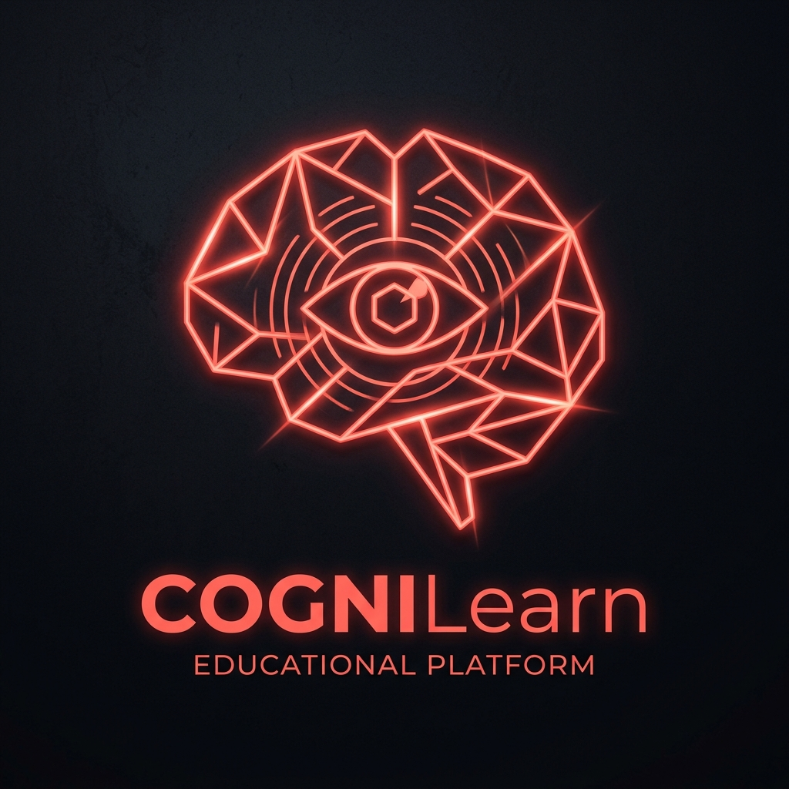
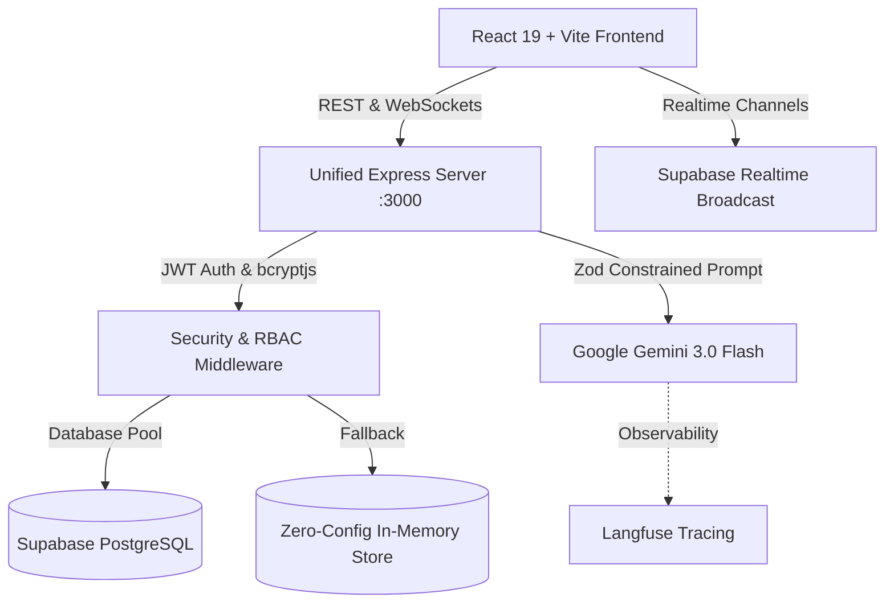

<div align="center">
  <br />
  
  <h1>🎓 CogniLearn AI</h1>
  <p><b>Privacy-First, Edge-AI Cognitive Learning, Attention Analytics & Classroom Intelligence Platform</b></p>
  
  [](https://react.dev/)
  [](https://www.typescriptlang.org/)
  [](https://vitejs.dev/)
  [](https://expressjs.com/)
  [](https://supabase.com/)
  [](https://deepmind.google/technologies/gemini/)
  [](https://langfuse.com/)
  [](https://tailwindcss.com/)
  [](https://github.com/)
  <br /><br />
</div>

---

## 🌟 Overview

**CogniLearn AI** is an enterprise-grade cognitive learning and educator analytics platform engineered for modern classrooms and independent study. It combines **Edge-First Computer Vision**, **mathematical gaze modeling**, and **structured generative AI** to optimize student engagement while strictly safeguarding biometric privacy.

Unlike traditional monitoring tools that stream intrusive video feeds to the cloud, CogniLearn processes 100% of video telemetry **locally in the browser** via WebAssembly and WebGL. Only anonymized, aggregated numeric telemetry (focus scores, PERCLOS fatigue, head pose vectors) ever touches the network.

> 📖 **Deep Dive Documentation**: For mathematical specifications, Kalman/Hungarian tracking details, and ER diagrams, see [ARCHITECTURE.md](ARCHITECTURE.md).

---

## ✨ Key Features

### 🎓 1. Student Experience
- **Interactive 3-Step Onboarding Wizard**:
  - **Account Security**: Real-time password strength meter and cryptographic credentials.
  - **AI Facial Calibration**: In-browser facial calibration reticle powered by MediaPipe Face Mesh; creates a 512-dimensional normalized embedding vector stored locally.
  - **Academic Profiling**: Dual-tier onboarding customized for **School** (Class 6–12, CBSE/ICSE, Board tracks) or **Higher Education** (B.Tech, B.Sc, B.Com, Semesters, Departments).
- **Gamified Focus Timer (Deep Work)**: Customizable Pomodoro blocks (5m to 60m) with ambient audio, streak tracking, and XP reward engines.
- **AI-Powered Diagnostics & Action Plans**: Post-session diagnostic reports providing cognitive indices, fatigue assessments, and actionable revision schedules synthesized by Google Gemini 3.0 Flash.

### 🏫 2. Educator & Classroom Portal
- **Real-Time Classroom Telemetry**: Split-screen live monitoring tracking cohort engagement, distraction risk indicators, and active student counts.
- **Multi-Face Edge Tracking**: In-camera multi-student detection utilizing:
  - **5-Point Umeyama Facial Alignment**
  - **Kalman Filter Position & Velocity Estimation**
  - **Hungarian (Kuhn-Munkres) Bipartite Spatial Association**
  - Continuous recognition against enrolled cohort student embeddings.
- **Cohort Management**: Generate unique class codes (`SCH-XXXX` or `COL-XXXX`), manage student rosters, and assign subject curricula.
- **Attendance & Engagement Logs**: Automatic attendance verification correlated with live attention metrics.

### 🔒 3. Privacy & Compliance
- **Zero-Cloud-Video Guarantee**: Camera frames are processed exclusively in the browser and discarded immediately. No video frames are ever recorded, streamed, or uploaded to servers.
- **DPDP Act 2023 (India) & COPPA/FERPA Compliant**: Biometric data is converted into one-way mathematical embeddings; all AI generation uses SHA-256 pseudonymized identifiers.
- **Zero Hallucinated Numbers**: Quantitative metrics (average focus, peak attention, minutes) are computed deterministically in TypeScript; Gemini is strictly constrained by Zod schemas for qualitative pedagogical insights.

---

## 🏗️ System Architecture



---

## 📁 Repository Structure

```text
COGNILEARN/
├── ARCHITECTURE.md              # Complete System Architecture & Mathematical Specification
├── supabase-schema.sql          # Supabase PostgreSQL DDL (Tables, Constraints, Indexes)
├── server/                      # Express.js Backend Application
│   ├── index.ts                 # Main Server Entrypoint & Unified Static Serving (:3000)
│   ├── supabase.ts              # Supabase Client & Relational Mapping Layer
│   ├── memoryStore.ts           # Zero-Config Fallback In-Memory Database with Demo Data
│   ├── authMiddleware.ts        # JWT Authentication & Role-Based Access Control (RBAC)
│   └── routes/
│       ├── auth.ts              # Student/Teacher Authentication & Face Descriptors
│       ├── cohorts.ts           # Class Cohort Management & IDOR-Protected Rosters
│       ├── student.ts           # Student Profiles, Focus Sessions & Break Logs
│       ├── user.ts              # Profile Updates, Account Deletion & Protected Reset
│       ├── baseline.ts          # Cognitive Baseline Assessments
│       └── report.ts            # Deterministic Stats Engine & Gemini AI Reporting
│
├── src/                         # React 19 Frontend Application
│   ├── components/
│   │   ├── Navbar.tsx           # Global Responsive Navigation Bar
│   │   ├── LandingPage.tsx      # Platform Hero Page & Architectural Features
│   │   ├── StudentAuth.tsx      # 3-Step Student Onboarding Wizard
│   │   ├── TeacherAuth.tsx      # Split-Screen Educator Authentication Portal
│   │   ├── StudentDashboard.tsx # Student Attention Analytics & Gamified Timer
│   │   ├── TeacherDashboard.tsx # Educator Live Classroom Monitoring & Tracking
│   │   ├── AcademicProfileForm.tsx # Dynamic School/College Profile Form
│   │   ├── ResetDatabaseModal.tsx  # Double-Confirmation Database Purge Dialog
│   │   └── AccountSettingsModal.tsx # Profile Management & Account Deletion
│   ├── services/
│   │   ├── api.ts               # Centralized REST API Client
│   │   ├── faceTracker.ts       # MediaPipe Edge Vision & Facial Reticle Engine
│   │   ├── faceMatcher.ts       # 512-D Cosine Metric Multi-Face Recognizer
│   │   ├── trackingHarness.ts   # Kalman + Hungarian Multi-Track Association
│   │   └── telemetryStream.ts   # Realtime WebSocket Streamer
│   ├── schemas/
│   │   └── academic.ts          # Zod Validation Schemas for Curricula & Auth
│   ├── types.ts                 # Core TypeScript Definitions
│   ├── App.tsx                  # Root Routing & State Management
│   └── main.tsx                 # React DOM Root
│
├── scripts/
│   └── test_pipeline.ts         # Automated Mathematical Verification Test Suite
├── .env.example                 # Environment Variable Reference
└── package.json                 # Project Dependencies & Build Scripts
```

---

## 🚀 Getting Started

### Prerequisites
- **Node.js**: v18.0.0 or higher (v20+ recommended)
- **npm**: v9.0.0 or higher
- **Supabase Account**: (Optional — application automatically runs in zero-config memory mode if unconfigured)

### 1. Installation
Clone the repository and install all dependencies:

```bash
git clone https://github.com/Kart-1307/CogniLearn.git
cd CogniLearn
npm install
```

### 2. Environment Configuration
Create a `.env` file in the root directory by copying `.env.example`:

```bash
cp .env.example .env
```

Configure your environment variables:

```env
# Authentication JWT Secret
JWT_SECRET=your_jwt_secret_here

# Supabase PostgreSQL Configuration (Optional: memory store activates if omitted)
SUPABASE_URL=https://your-project-id.supabase.co
VITE_SUPABASE_URL=https://your-project-id.supabase.co
SUPABASE_SERVICE_ROLE_KEY=your-supabase-service-role-key
SUPABASE_ANON_KEY=your-supabase-anon-key
VITE_SUPABASE_ANON_KEY=your-supabase-anon-key

# Google Gemini AI Configuration
GEMINI_API_KEY=AIzaSy...your_gemini_api_key_here
GEMINI_MODEL=gemini-3.0-flash

# Langfuse Observability (Optional)
LANGFUSE_PUBLIC_KEY=pk-lf-...
LANGFUSE_SECRET_KEY=sk-lf-...
LANGFUSE_BASEURL=https://cloud.langfuse.com
```

### 3. Database Initialization (Supabase PostgreSQL)
If using Supabase:
1. Open your Supabase Project Dashboard.
2. Navigate to the **SQL Editor**.
3. Copy the entire contents of [`supabase-schema.sql`](supabase-schema.sql) and execute it.
4. All 9 tables, indexes, check constraints, and foreign key cascades will be created automatically.

---

## 💻 Running the Application

### Development Server
Starts the unified Express backend and Vite development server on **Port 3000**:

```bash
npm run dev
```

Navigate to [http://localhost:3000](http://localhost:3000) in your browser.

### Run Automated Test Suite
Executes the comprehensive 6-phase mathematical test suite (Kalman filter, Hungarian algorithm, Umeyama alignment, 512-D L2 normalization, attention classification, tracking diagnostics):

```bash
npm test
```

### TypeScript Type-Checking
```bash
npm run lint
```

### Production Build
Generates the optimized client bundle and compiled Node.js server:

```bash
npm run build
npm start
```

---

## 👥 Demo Credentials

For quick evaluation during hackathons and demonstrations, CogniLearn provides instant demo accounts:

| Role | Academic Tier | Email | Password |
| :--- | :--- | :--- | :--- |
| **Teacher (School)** | K-12 Secondary | `teacher@cognilearn.com` | `TeacherPass123!` |
| **Teacher (College)** | Higher Education | `college-teacher@cognilearn.com` | `TeacherPass123!` |
| **Student (School)** | Class 10 CBSE | `student@cognilearn.com` | `StudentPass123!` |
| **Student (College)** | B.Tech CSE | `college-student@cognilearn.com` | `StudentPass123!` |

*(You can also register brand-new teacher and student accounts through the interactive onboarding wizards!)*

---

## 📜 License

Distributed under the **MIT License**. See `LICENSE` for details.
